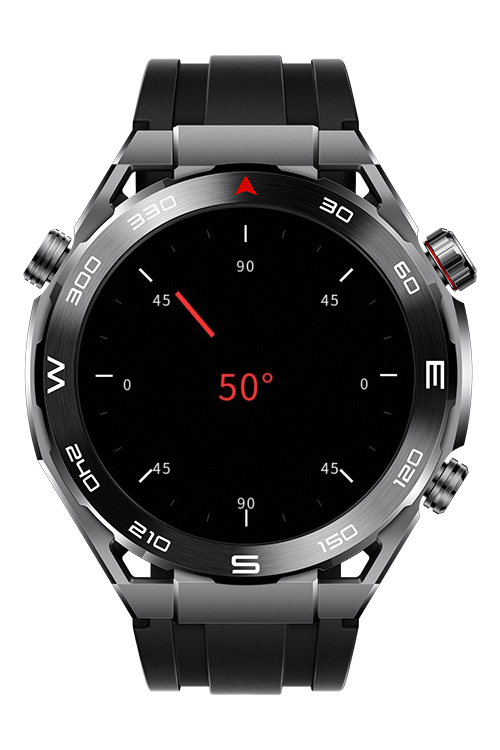

> **Note:** To access all shared projects, get information about environment setup, and view other guides, please visit [Explore-In-HMOS-Wearable Index](https://github.com/Explore-In-HMOS-Wearable/hmos-index).

# How to Build Inclinometer?

A real-time inclinometer built for Huawei Sport Watches.

# Preview

<div>
 
</div>

# Use Cases

- Live tilt measurement using the device's accelerometer
- Analog dial display rendered on <canvas>, with tick marks and mirrored 0-45-90 degree labels
- Rotating needle that tracks the current tilt angle in real time

# Technology

## Stack

- **Languages**: JS
- **Frameworks**: HarmonyOS SDK 4.0.0(10)
- **Tools**: DevEco Studio Vers 6.0.1(21)

# Directory Structure

```
entry/src/main/js/MainAbility
│
├── pages/
│   ├── index.css
│   ├── index.hml
│   └── index.js
│
├── FileService.js
│
├── i18n/
│   ├── en-US.json
│   └── zh-CN.json
│
└── app.js
```

# Constraints and Restrictions

## Supported Devices

- Huawei Sport (Lite) Watch GT 4/5/6
- Huawei Sport (Lite) GT5/6 Pro
- Huawei Sport (Lite) Fit 3/4
- Huawei Sport (Lite) D2
- Huawei Sport (Lite) Ultimate

# License

**How to Build Inclinometer?** is distributed under the terms of the MIT License
See the [LICENSE](./LICENSE) for more information.